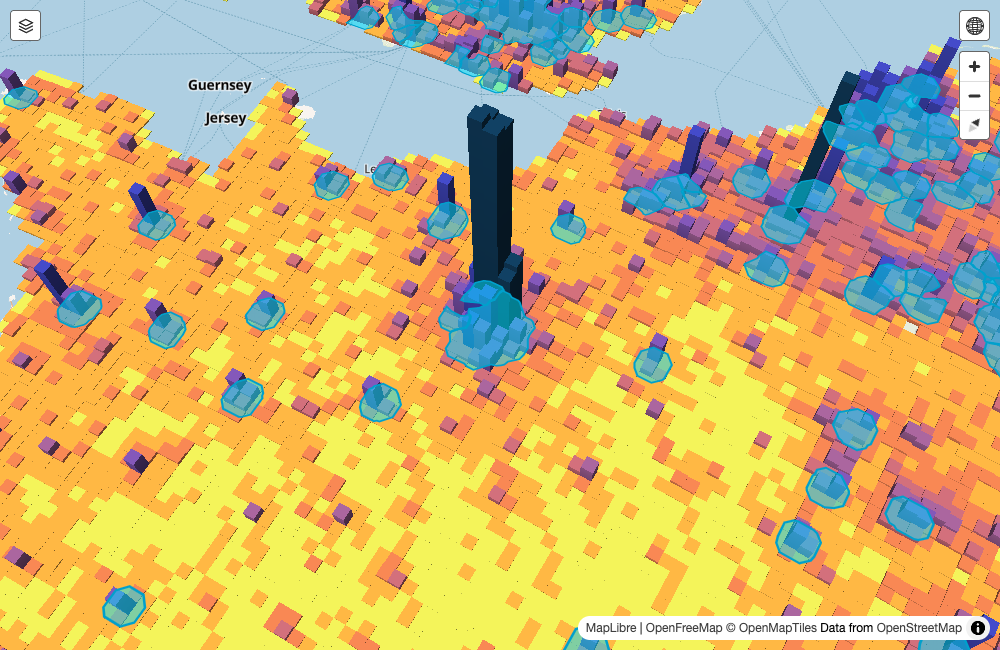

```{r, include = FALSE}
library(tmap)
tmap_mode("plot")
tmap_options(frame = FALSE, legend.frame = FALSE, legend.bg = FALSE)
# map variables slide: legends at the same place in all maps
legend_topleft = tm_layout(legend.position = tm_pos_in("left", "top"))
NLD_muni$pop_dens = NLD_muni$population / as.numeric(NLD_muni$area)   # per km2
```

<!-- Live maps: maps/toy_*.html (talk_prep/talk_toy_maps.R) and maps/world_globe.html, europe_10km.html,
     nld_health*.html (talk_prep/talk_examples.R). Embedded as iframes, loaded when the slide is shown.
     Basemaps need an internet connection. -->

# tmap in 1 minute

## Map variables

:::: {.columns}
::: {.column width="33%"}
```{r, echo = TRUE, eval = FALSE}
tm_shape(NLD_muni) +
  tm_polygons(
    fill = "orange"
  )
```
```{r mapvar-constant, fig.width = 3.5, fig.height = 4.2}
tm_shape(NLD_muni) +
  tm_polygons(
    fill = "orange"
  )
```
::: {.map-label}
**constant**
:::
:::
::: {.column width="33%"}
```{r, echo = TRUE, eval = FALSE}
tm_shape(NLD_muni) +
  tm_polygons(
    fill = "employment_rate"
  )
```
```{r mapvar-variable, fig.width = 3.5, fig.height = 4.2}
tm_shape(NLD_muni) +
  tm_polygons(
    fill = "employment_rate"
  ) + legend_topleft
```
::: {.map-label}
**data variable**
:::
:::
::: {.column width="33%"}
```{r, echo = TRUE, eval = FALSE}
tm_shape(NLD_muni) +
  tm_polygons() +
  tm_bubbles(
    fill = "orange",
    size = "population")
```
```{r mapvar-both, fig.width = 3.5, fig.height = 4.2}
tm_shape(NLD_muni) +
  tm_polygons() +
  tm_bubbles(
    fill = "orange",
    size = "population") + legend_topleft
```
```{=html}
<table class="map-label-table">
<tr><td><b>constant</b></td><td>fill</td></tr>
<tr><td><b>data-driven</b></td><td>size</td></tr>
</table>
```
:::
::::

## Modes: `"plot"` → `"view"` {.nostretch}

```{r, echo = TRUE, eval = FALSE}
tmap_mode("view")
tm_shape(NLD_muni) + tm_polygons(fill = "employment_rate")
```

<iframe data-src="maps/toy_view.html" width="100%" height="460px" style="border:none;"></iframe>

[Same code]{.smaller-body} [Leaflet]{.smaller-body .gap} [`ttm()` / `rtm()` to switch]{.smaller-body .gap}

## tmap v4: extension packages

```{=html}
<div class="ext-grid">
  <div class="ext-box ext-highlight">
    <div class="ext-badge">this talk</div>
    <div class="ext-head">Graphics mode</div>
    <table>
      <tr><td class="pkg">tmap.mapgl</td><td><code>"maplibre"</code><br><code>"mapbox"</code></td></tr>
    </table>
  </div>
  <div class="ext-box">
    <div class="ext-head">Layer type</div>
    <table>
      <tr class="ext-this"><td class="pkg">tmap.mapgl</td><td><code>tm_polygons_3d()</code></td></tr>
      <tr><td class="pkg">tmap.cartogram</td><td><code>tm_cartogram()</code><br><code>tm_cartogram_ncont()</code><br><code>tm_cartogram_dorling()</code></td></tr>
      <tr><td class="pkg">tmap.glyphs</td><td><code>tm_donuts()</code><br><code>tm_pies()</code><br><code>tm_flowers()</code></td></tr>
      <tr><td class="pkg">tmap.networks</td><td><code>tm_network()</code><br><code>tm_edges()</code><br><code>tm_nodes()</code></td></tr>
    </table>
  </div>
  <div class="ext-box">
    <div class="ext-head">Data type</div>
    <table>
      <tr><td class="pkg">tmap.networks</td><td>sfnetworks</td></tr>
      <tr><td class="pkg">tmap.sources</td><td>remote, tiled, streaming (e.g. Overture Maps)</td></tr>
    </table>
  </div>
</div>
```

## Mode `"maplibre"` {.nostretch}

```{r, echo = TRUE, eval = FALSE}
library(tmap.mapgl)
tmap_mode("maplibre")
tm_shape(NLD_muni) + tm_polygons(fill = "employment_rate")
```

<iframe data-src="maps/toy_maplibre.html" width="100%" height="460px" style="border:none;"></iframe>

## 3D: one extra map variable, `height` {.nostretch}

```{r, echo = TRUE, eval = FALSE}
tm_shape(NLD_muni) +
  tm_polygons_3d(height = "pop_dens", fill = "employment_rate") +
  tm_maplibre(pitch = 50)
```

<iframe data-src="maps/toy_3d.html" width="100%" height="430px" style="border:none;"></iframe>

[Height = density → **volume = count**]{.smaller-body} [colour free for a second variable]{.smaller-body .gap}

# Example 1: population

## WorldPop

- Gridded population, **global**, 2025
- **30″ × 30″** cells: "1 km", but only at the equator
  - Paris: 0.93 × 0.61 km = 0.57 km²
- So: aggregate **density** (1a) or reproject to an **equal-area** grid (1b)
- Open data: CC BY 4.0, [worldpop.org](https://www.worldpop.org)


## 1a. The world {.nostretch}

<iframe data-src="maps/world_globe.html" width="100%" height="510px" style="border:none;"></iframe>

[~60 km cells]{.smaller-body} [height and colour: inhabitants per km²]{.smaller-body .gap} [globe projection]{.smaller-body .gap}

## 1b. Europe {.nostretch}

<iframe data-src="maps/europe_10km.html" width="100%" height="510px" style="border:none;"></iframe>

[10 km equal-area grid (LAEA)]{.smaller-body} [hover over a city]{.smaller-body .gap}

## Hover areas

:::: {.columns}
::: {.column width="68%"}
{style="width:100%;"}
:::
::: {.column width="32%"}
[Hover per column: thin, hidden behind each other]{.smaller-body}

[Instead: one **hover area** per city]{.smaller-body}

[Urban centre + ≤ 10 km]{.smaller-body}

[Invisible, but hoverable ([made visible here]{style="color:#00A0CC;"})]{.smaller-body}

```{r, echo = TRUE, eval = FALSE}
tm_shape(urban) +
  tm_polygons(
    fill_alpha = 0,
    col_alpha = 0,
    hover = "label")
```
:::
::::

# New in tmap: patterns and textures

## Patterns

:::: {.columns}
::: {.column width="50%"}
```{r, echo = TRUE, eval = FALSE}
tm_polygons(
  fill = "white",
  pattern = "name")
```
```{r pat-names, fig.width = 5, fig.height = 3.6}
tm_shape(NLD_prov) +
  tm_polygons(fill = "white", pattern = "name", pattern.legend = tm_legend_hide())
```
:::
::: {.column width="50%"}
```{r, echo = TRUE, eval = FALSE}
tm_polygons(
  fill = "employment_rate",
  pattern = "dots",
  pattern_density = "pop_dens",
  pattern_density.scale =
    tm_scale_intervals(style = "quantile"))
```
```{r pat-dots-dens, fig.width = 5, fig.height = 3.6}
tm_shape(NLD_muni) +
  tm_polygons(fill = "employment_rate", pattern = "dots", pattern_density = "pop_dens",
    pattern_density.scale = tm_scale_intervals(style = "quantile"), lwd = 0.5) +
  tm_layout(legend.position = tm_pos_out("right", "center"))
```
:::
::::

[New map variables: `pattern`, `pattern_col`, `pattern_density`, `pattern_size`]{.smaller-body}

## Textures

:::: {.columns}
::: {.column width="50%"}
```{r, echo = TRUE, eval = FALSE}
tm_polygons(
  fill = "employment_rate",
  pattern = tm_patterns("mottle",
    grain = 0.15, contrast = 1.5),
  pattern_density = "pop_dens",
  pattern_density.scale =
    tm_scale_intervals(style = "quantile"))
```
```{r tex-mottle-dens, fig.width = 5, fig.height = 3.2}
tm_shape(NLD_muni) +
  tm_polygons(fill = "employment_rate", pattern = tm_patterns("mottle", grain = 0.15, contrast = 1.5), pattern_density = "pop_dens",
    pattern_density.scale = tm_scale_intervals(style = "quantile"), lwd = 0.5) +
  tm_layout(legend.position = tm_pos_out("right", "center"))
```
:::
::: {.column width="50%"}
```{r, echo = TRUE, eval = FALSE}
tm_polygons(
  fill = "employment_rate",
  pattern = "sketch",
  pattern_density = "pop_dens",
  pattern_density.scale =
    tm_scale_intervals(style = "quantile",
      values.range = c(1, 0)))
```
```{r tex-sketch-dens, fig.width = 5, fig.height = 3.2}
tm_shape(NLD_muni) +
  tm_polygons(fill = "employment_rate", pattern = "sketch", pattern_density = "pop_dens",
    pattern_density.scale = tm_scale_intervals(style = "quantile", values.range = c(1, 0)), lwd = 0.5) +
  tm_layout(legend.position = tm_pos_out("right", "center"))
```
:::
::::

[Idea: texture = **uncertainty**]{.smaller-body} [colour stays readable]{.smaller-body .gap} [all modes, also 3D roofs]{.smaller-body .gap}

# Example 2: health

## Health per district

- **Health Monitor Adults and Elderly 2024** (Municipal Health Services, CBS, RIVM)
- % adults with **good or very good** health
- **Model-based** small area estimates, **3,393 districts**
- With **95% intervals**: wide for small districts

```{=html}
<table class="mapvars">
<tr><td rowspan="2">Map variables:</td><td><code>height</code></td><td>=</td><td>population density</td></tr>
<tr><td><code>fill</code></td><td>=</td><td>difference with the Dutch average</td></tr>
</table>
```

## 2a. Height + colour {.nostretch}

<iframe data-src="maps/nld_health.html" width="100%" height="545px" style="border:none;"></iframe>

## 2b. + texture `"mottle"` {.nostretch}

<iframe data-src="maps/nld_health_mottle.html" width="100%" height="545px" style="border:none;"></iframe>

[Wider interval → more 'poorly painted' roof]{.smaller-body} [Average colour unchanged]{.smaller-body .gap}

## 2c. + texture `"sketch"` {.nostretch}

<iframe data-src="maps/nld_health_sketch.html" width="100%" height="545px" style="border:none;"></iframe>

[Wider interval → sketchier roof]{.smaller-body}

## Thank you

- tmap: [r-tmap.github.io/tmap](https://r-tmap.github.io/tmap/)
- tmap.mapgl: [r-tmap.github.io/tmap.mapgl](https://r-tmap.github.io/tmap.mapgl/)
- Slides + code: [github.com/r-tmap/tmap-tutorial-uros2026](https://github.com/r-tmap/tmap-tutorial-uros2026)

```{r, eval = FALSE, echo = TRUE}
install.packages(c("tmap", "tmap.mapgl"))
```
