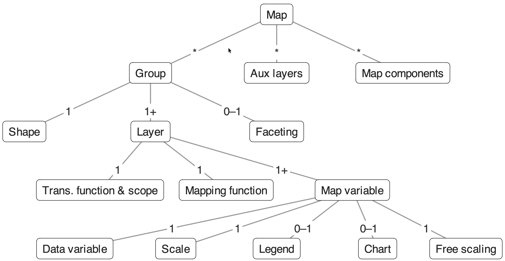
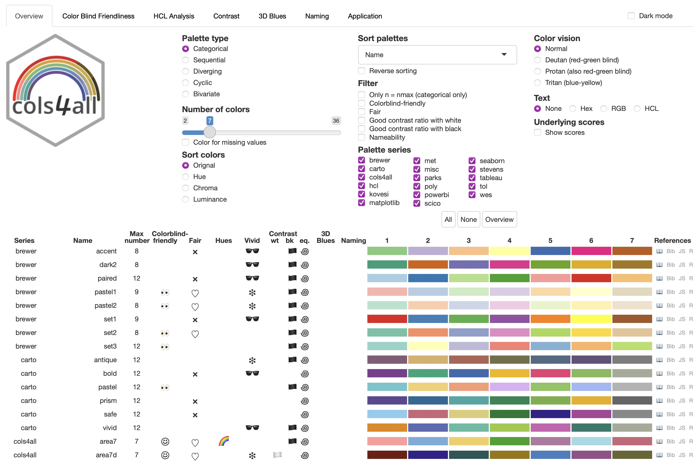
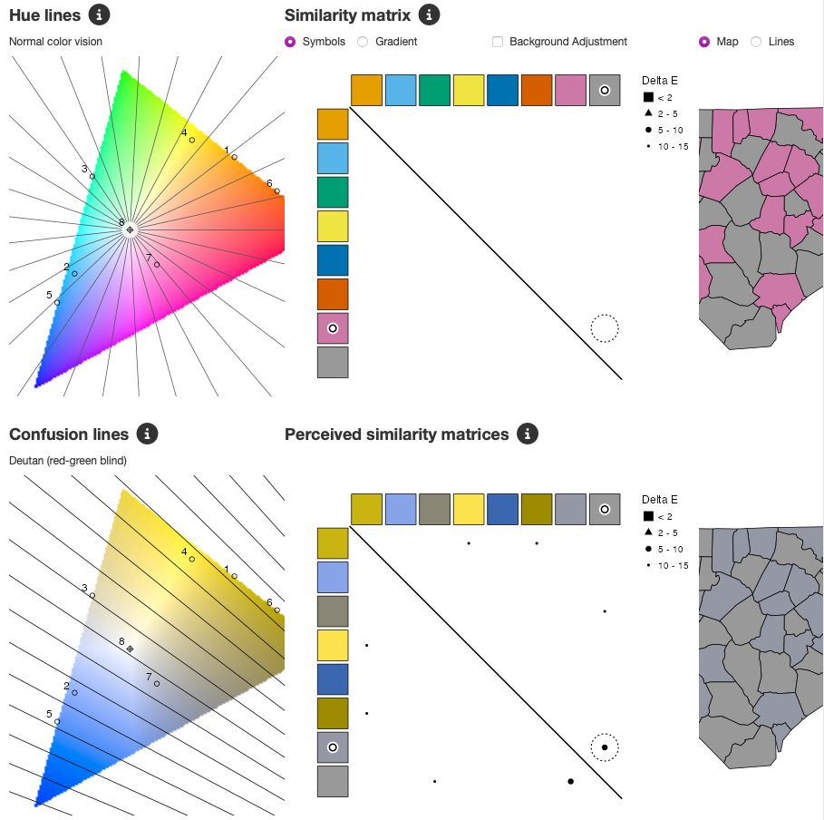

```{r, include = FALSE}
library(tmap)
library(cols4all)
library(sf)
```

# Welcome

## About this tutorial

**Goal**: make clear, honest and accessible maps of official statistics in R.

| Time | Part |
|------|------|
| 11:00 | 1. tmap in a nutshell + exercise 1 |
| 11:20 | 2. Colours with cols4all + exercise 2 |
| 11:45 | 3. Mapping official statistics + exercise 3 |
| 12:10 | 4. Interactive and 3D maps + exercise 4 |
| 12:25 | Wrap-up and questions |

Materials: [github.com/mtennekes/tmap-tutorial-uros2026](https://github.com/mtennekes/tmap-tutorial-uros2026)

- `tutorial.qmd`: these slides
- `exercises.R`: exercises (solutions in `solutions.R`)

## Setup

```{r, eval = FALSE}
install.packages(c("tmap", "cols4all", "tmap.cartogram", "tmap.glyphs", "tmap.mapgl"))

# or the whole family at once:
install.packages("tmapverse")
```

Check: this should show a map of Dutch municipalities.

```{r, eval = FALSE}
library(tmap)
tm_shape(NLD_muni) + tm_polygons("income_high")
```

All data used today ship with **tmap**: no internet connection needed (except for basemaps).

## The tmapverse

| Package | What it adds |
|---------|-------------|
| **tmap** | Thematic maps: static (`"plot"`) and interactive (`"view"`) |
| **cols4all** | Colour palettes: analyse, compare, choose |
| **tmap.cartogram** | Cartograms: contiguous, non-contiguous, Dorling |
| **tmap.glyphs** | Glyph maps: donuts, flowers |
| **tmap.networks** | Network and flow maps |
| **tmap.mapgl** | Interactive modes `"maplibre"` and `"mapbox"`, 3D polygons |

Under the hood: **sf**, **terra**, **stars**.

## Data today: Statistics Netherlands (CBS)

```{r}
names(NLD_muni)
```

- `NLD_prov` (12 provinces), `NLD_muni` (345 municipalities), `NLD_dist` (3340 districts)
- Key figures 2022 from CBS: population, age, dwellings, income, education, urbanity
- `World`: country-level indicators (well-being, inequality, press freedom, ...)

Replace these with your own regions: anything readable by **sf** or **terra** works (GISCO/NUTS, census grids, ...).

# 1. tmap in a nutshell

## The grammar

{.r-stretch}

A map consists of **shapes** (spatial data) with **layers** on top, plus **map components** (title, legend, scalebar, ...).

## Building a map, step by step

```{r}
#| output-location: slide
tm_shape(NLD_muni) +                         # shape: the spatial data
  tm_polygons(
    fill = "edu_appl_sci",                   # map variable: fill
    fill.scale = tm_scale_intervals(),       # how data -> colours
    fill.legend = tm_legend("University degree (%)")) +  # legend
tm_shape(NLD_prov) +                         # a second shape
  tm_borders(lwd = 2) +                      # its layer
tm_title("Higher education per municipality, 2022") +
tm_credits("Source: Statistics Netherlands (CBS)")
```

## Map variables

Every layer has **map variables** (visual variables):

| Layer | Map variables |
|-------|---------------|
| `tm_polygons()` | `fill`, `col`, `lwd`, `lty`, `fill_alpha`, `col_alpha` |
| `tm_symbols()`, `tm_bubbles()`, `tm_dots()` | `size`, `shape`, `fill`, `col`, ... |
| `tm_lines()` | `col`, `lwd`, `lty` |
| `tm_raster()` | `col` |
| `tm_text()` | `text`, `size`, `col` |

Each map variable is either **constant** (`fill = "red"`) or **data-driven** (`fill = "income_high"`).

A data-driven map variable `x` comes with `x.scale`, `x.legend`, `x.chart` and `x.free`.

## Scales: from data to colours (or sizes)

| Scale function | Use |
|----------------|-----|
| `tm_scale_intervals()` | classified: `style` = `"pretty"`, `"quantile"`, `"kmeans"`, `"fisher"`, `"fixed"` |
| `tm_scale_continuous()` | unclassified gradient (also for sizes) |
| `tm_scale_categorical()` / `tm_scale_ordinal()` | categories (unordered / ordered) |
| `tm_scale_bivariate()` | two variables, one colour |
| `tm_scale_asis()` | data already contains colours / sizes |

```{r, eval = FALSE}
fill.scale = tm_scale_intervals(style = "fixed", breaks = c(0, 15, 20, 25, 50),
                                values = "brewer.blues")
```

## Same data, different classification

```{r}
#| output-location: slide
tm_shape(NLD_muni) +
  tm_polygons(
    fill = rep("dwelling_value", 3),
    fill.scale = list(
      tm_scale_intervals(style = "pretty"),
      tm_scale_intervals(style = "quantile"),
      tm_scale_intervals(style = "fisher")),
    fill.legend = tm_legend("Avg. dwelling value\n(x 1000 euro)"),
    col = NULL) +
tm_layout(panel.labels = c("pretty", "quantile", "fisher"))
```

## Choosing a classification

- `"pretty"`: round numbers, easy to communicate; may leave classes nearly empty
- `"quantile"`: equal numbers of areas per class; small differences can look large
- `"fisher"` / `"kmeans"`: natural groups in the data
- `"fixed"`: policy thresholds, EU averages, or the same breaks over years (comparability!)

For **publications that are repeated** (yearly, monthly), fix the breaks: otherwise colours change meaning between editions.

## Facets: small multiples

```{r}
#| output-location: slide
tm_shape(NLD_muni) +
  tm_polygons(
    fill = c("pop_0_14", "pop_25_44", "pop_65plus"),
    fill.scale = tm_scale_intervals(values = "brewer.purples"),
    fill.legend = tm_legend("Share of population (%)"),
    fill.free = FALSE,                       # one common scale
    col = NULL) +
tm_layout(panel.labels = c("0-14", "25-44", "65+"))
```

Also: `tm_facets_wrap("province")`, `tm_facets_grid()`, and animations with `tm_facets_pagewise()` + `tmap_animation()`.

## Exercise 1 (5 min)

Open `exercises.R`.

1. Make a choropleth of `employment_rate` per municipality (`NLD_muni`).
2. Use `tm_scale_intervals()` with `style = "fixed"` and breaks at 60, 65, 70, 75.
3. Add the province borders, a title and a credits line with the source.
4. *Bonus*: make facets per `urbanity`.

# 2. Colours with cols4all

## Colour is the most used map variable

- A palette can **reveal** or **hide** patterns
- A palette can suggest an order that is not there (or hide one that is)
- About **8% of men and 0.5% of women** have a colour vision deficiency (CVD)
- Official statistics have a duty of **accessibility**: e.g. the EU Web Accessibility Directive (WCAG)

## Palette types

| Data | Palette type | Example |
|------|--------------|---------|
| Categories without order | categorical | NACE section, land use |
| Ordered, one direction | sequential | population density, income |
| Ordered, meaningful midpoint | diverging | change (−/+), deviation from EU average |
| Cyclic | cyclic | month, hour of day |
| Two variables | bivariate | income × education |

Rule of thumb: **the data determine the palette type**, the house style determines the hue.

## cols4all

- Hundreds of palettes: ColorBrewer, HCL, viridis, scico, Paul Tol, Tableau, Okabe-Ito, ...
- Scores on **colour-blind friendliness**, **fairness**, **contrast**, **vividness**
- Also analyses **your own (corporate) palettes**
- Used by tmap; also usable in ggplot2 (`scale_fill_continuous_c4a_seq()` etc.) and base R

```{r, eval = FALSE}
library(cols4all)
c4a_gui()
```

## The cols4all dashboard

{.r-stretch}

## Getting colours

```{r}
c4a("brewer.blues", n = 5)
c4a("-brewer.blues", n = 5)                     # reversed
c4a_palettes(type = "div", series = "tol")      # which diverging Tol palettes?
```

In tmap, palettes are passed via `values` in the scale function:

```{r, eval = FALSE}
fill.scale = tm_scale_intervals(values = "tol.sunset")
fill.scale = tm_scale_continuous(values = "-pu_gn_div", midpoint = 0)
```

## Colour-blind friendliness

{.r-stretch}

*Analysis of `misc.okabe`: the dashboard simulates deuteranopia, protanopia and tritanopia.*

## Simulating CVD on a map

```{r}
#| output-location: slide
#| fig-height: 3.5
pal_bad  = c4a("brewer.rd_yl_gn", n = 7)
pal_good = c4a("pu_gn_div", n = 7)
m = function(pal, title) {
  tm_shape(NLD_muni) +
    tm_polygons("employment_rate", col = NULL,
      fill.scale = tm_scale_intervals(n = 7, values = pal),
      fill.legend = tm_legend_hide()) +
    tm_title(title, size = 0.9)
}
tmap_arrange(
  m(pal_bad, "Red-yellow-green"), m(colorspace::deutan(pal_bad), "... with deuteranopia"),
  m(pal_good, "Purple-green"),     m(colorspace::deutan(pal_good), "... with deuteranopia"),
  ncol = 4)
```

## Diverging: deviation from the national average

```{r}
#| output-location: slide
NLD_muni$emp_dev = NLD_muni$employment_rate -
  weighted.mean(NLD_muni$employment_rate, NLD_muni$population, na.rm = TRUE)

tm_shape(NLD_muni) +
  tm_polygons(
    fill = "emp_dev",
    fill.scale = tm_scale_intervals(
      breaks = c(-15, -6, -3, -1, 1, 3, 6, 15),
      values = "cols4all.pu_gn_div",
      midpoint = 0),
    fill.legend = tm_legend("Employment rate,\ndeviation from NL (%-pt)"),
    col = "white", lwd = 0.3) +
tm_shape(NLD_prov) + tm_borders(col = "grey30")
```

## Your house style

Most statistical offices have a corporate palette. Analyse it before using it on a map:

```{r, eval = FALSE}
house = c("#00a1cd", "#0058b8", "#afcb05", "#53a31d", "#f39200", "#e94c0a")
c4a_gui(pal = house)          # test it in the dashboard
c4a_plot(house, include.cvd = TRUE)
```

```{r, echo = FALSE, fig.height = 2.5, out.height = "40%"}
house = c("#00a1cd", "#0058b8", "#afcb05", "#53a31d", "#f39200", "#e94c0a")
c4a_plot(house, include.cvd = TRUE)
```

Often fine for categorical charts, but **not** for sequential maps: build a sequential scale from **one** house hue instead.

## Contrast and vividness

- **Pastel (low saturation)** colours for large areas (choropleths); vivid colours for small objects (points, lines) and highlights
- **Borders**: thin white borders recede; black borders compete with dark classes
- **Missing values**: a colour that cannot be confused with the palette (`value.na`)
- **WCAG**: at least 3:1 contrast for informative non-text elements

## Exercise 2 (7 min)

1. Run `c4a_gui()`. Find a **sequential**, colour-blind friendly palette you like.
2. Use it for the map of exercise 1.
3. Map `dwelling_ownership` minus its national average with a **diverging** palette and `midpoint = 0`.
4. *Bonus*: analyse the house-style palette of your own institute with `c4a_gui(pal = ...)`.

# 3. Mapping official statistics

## Choropleths are for rates, not counts

```{r}
#| output-location: slide
#| fig-height: 4
tmap_arrange(
  tm_shape(NLD_muni) +
    tm_polygons("population", col = NULL,
      fill.scale = tm_scale_intervals(style = "fisher", values = "brewer.blues")) +
    tm_title("Wrong: count as colour"),
  tm_shape(NLD_muni) +
    tm_polygons(fill = "grey90", col = "white") +
    tm_bubbles(size = "population", fill = "steelblue", col = "white") +
    tm_title("Better: count as size"),
  ncol = 2)
```

Large areas attract attention, regardless of their population.

## Counts: area-proportional alternatives

- **Bubbles**: `tm_bubbles(size = "population")`
- **Cartograms** (**tmap.cartogram**): area of each region proportional to the count
- **Density** (count / km^2^) as colour; with **3D**, *height* = density so *volume* = count (part 4)
- Grids (e.g. 1 km^2^ census grids) avoid the problem: all cells have the same area

## Cartograms

```{r}
#| output-location: slide
library(tmap.cartogram)
tm_shape(NLD_muni) +
  tm_cartogram_dorling(
    size = "population",
    fill = "income_high",
    fill.scale = tm_scale_intervals(values = "brewer.yl_gn_bu", style = "fisher"),
    fill.legend = tm_legend("High income\nhouseholds (%)"),
    col = "white") +
tm_title("Municipalities sized by population")
```

Also `tm_cartogram()` (contiguous) and `tm_cartogram_ncont()` (non-contiguous). Use an equal-area CRS.

## Suppressed and missing values

`NLD_dist` has missing income figures. Who are they?

```{r}
d = st_drop_geometry(NLD_dist)
summary(d$population[is.na(d$income_high)])
```

All districts with at most 525 inhabitants: values not published for **confidentiality**.

A blank or grey area should tell the reader **why** it is empty.

## Showing suppressed values

```{r}
#| output-location: slide
#| fig-height: 5
ams = NLD_dist[NLD_dist$province %in% c("Noord-Holland", "Flevoland"), ]
tm_shape(ams) +
  tm_polygons(
    fill = "income_high",
    fill.scale = tm_scale_intervals(
      style = "fixed", breaks = c(0, 10, 15, 20, 25, 30, 60),
      values = "brewer.purples",
      value.na = "white", label.na = "Not published\n(< 550 inhabitants)"),
    fill.legend = tm_legend("High income households (%)"),
    col = "grey60", lwd = 0.3) +
tm_layout(frame = FALSE)
```

Combine with statistical disclosure control upstream (see the **rtauargus** tutorial, Room 3).

## Two variables at once: bivariate choropleth

```{r}
#| output-location: slide
#| fig-height: 6
tm_shape(NLD_muni) +
  tm_polygons(
    fill = tm_vars(c("income_high", "edu_appl_sci"), multivariate = TRUE),
    fill.scale = tm_scale_bivariate(
      scale1 = tm_scale_intervals(style = "quantile", n = 3, labels = c("L", "M", "H")),
      scale2 = tm_scale_intervals(style = "quantile", n = 3, labels = c("L", "M", "H")),
      values = "pu_gn_bivs"),
    fill.legend = tm_legend_bivariate(
      xlab = "High income", ylab = "University degree",
      item.r = 0, item.width = 2, item.height = 2,
      position = tm_pos_in("left", "top")),
    col = "white", lwd = 0.5) +
tm_shape(NLD_prov) + tm_borders(col = "grey20", lwd = 1.5) +
tm_layout(frame = FALSE)
```

## Reading a bivariate map

- 3 × 3 classes; the legend is essential
- Diagonal (low-low, high-high) shows **correlation**; off-diagonal corners show **exceptions**
- Bivariate palettes in cols4all: `c4a_palettes(type = "bivs")`, and `"bivc"`, `"bivd"`, `"bivg"`
- Explain the legend to a general audience, or use facets instead

## Composition: donut maps

```{r}
#| output-location: slide
#| fig-height: 6
library(tmap.glyphs)
ZH_muni = NLD_muni[NLD_muni$province == "Zuid-Holland", ]
ZH_muni$income_middle = 100 - ZH_muni$income_high - ZH_muni$income_low
tm_shape(ZH_muni) +
  tm_polygons(fill = "grey95", col = "grey70") +
  tm_donuts(
    parts = tm_vars(c("income_low", "income_middle", "income_high"), multivariate = TRUE),
    fill.scale = tm_scale_categorical(values = "-pu_gn_div",
      labels = c("Low", "Middle", "High")),
    fill.legend = tm_legend("Income group"),
    size = "population",
    size.scale = tm_scale_continuous(ticks = c(50000, 100000, 250000, 500000)),
    size.legend = tm_legend("Population"))
```

## Publication layout and export

```{r}
#| output-location: slide
map = tm_shape(NLD_muni) +
  tm_polygons("edu_appl_sci",
    fill.scale = tm_scale_intervals(style = "fixed", breaks = c(10, 20, 25, 30, 40, 60),
                                    values = "tol.iridescent"),
    fill.legend = tm_legend("University\ndegree (%)", position = tm_pos_in("left", "top"),
                            frame = FALSE),
    col = "white", lwd = 0.3) +
  tm_shape(NLD_prov) + tm_borders(col = "grey25") +
  tm_scalebar(position = c("right", "bottom")) +
  tm_credits("Source: CBS, 2022", position = c("right", "bottom")) +
  tm_layout(frame = FALSE, fontfamily = "sans")
map
```

```{r, eval = FALSE}
tmap_save(map, "edu.png", width = 1600, height = 1900, dpi = 300)
tmap_save(map, "edu.pdf")    # vector output for print
```

## Styles: one look for all your maps

```{r, eval = FALSE}
tmap_options(
  frame = FALSE,
  value.na = "white",
  label.na = "Not published",
  legend.frame = FALSE,
  text.fontfamily = "sans")
tmap_options_save("my_institute")      # save as a named style

tmap_style("my_institute")            # use it later
```

Put this in an internal package: every map from your office has the same look.

## Exercise 3 (10 min)

1. Map the **number of dwellings** (`dwelling_total`) per municipality as bubbles on top of a light grey choropleth.
2. Now make a Dorling cartogram sized by `dwelling_total` and coloured by `dwelling_ownership`.
3. Make a district map (`NLD_dist`) of one province of your choice for `income_low`, with a clear label for suppressed values.
4. *Bonus*: bivariate map of `income_low` and `pop_65plus`. Which palette from `c4a_palettes(type = "bivs")` works best?

# 4. Interactive and 3D maps

## One line to go interactive

```{r, eval = FALSE}
tmap_mode("view")        # or: ttm() to toggle

tm_shape(NLD_muni) +
  tm_polygons("edu_appl_sci",
    fill.scale = tm_scale_intervals(values = "tol.iridescent"),
    hover = "name",
    popup = tm_popup(vars = c("Population" = "population",
                                "University degree (%)" = "edu_appl_sci",
                                "High income (%)" = "income_high"))) +
tm_basemap("CartoDB.Positron")
```

The same map code, rendered with Leaflet.

- `hover`: label on mouse-over; `popup = tm_popup()`: table on click
- `group`: layers that can be switched on and off

## Sharing interactive maps

```{r, eval = FALSE}
tmap_save(map, "edu.html")                      # standalone HTML file
```

- Embed in **Quarto** / R Markdown reports and websites
- **Shiny**: `renderTmap()`, `tmapOutput()`, `tmapProxy()`

## tmap.mapgl: MapLibre and Mapbox

```{r, eval = FALSE}
library(tmap.mapgl)
tmap_mode("maplibre")   # free; "mapbox" needs an API key
rtm()                   # rotate: plot -> view -> mapbox -> maplibre
```

- **WebGL** rendering: fast with many features (all 3340 districts, grids, ...)
- Globe projection, vector basemaps
- A new layer: `tm_polygons_3d()`

## 3D: height = density, volume = count

```{r, eval = FALSE}
tmap_mode("maplibre")
NLD_dist$pop_dens = NLD_dist$population / NLD_dist$area

tm_shape(NLD_dist) +
  tm_polygons_3d(
    height = "pop_dens",
    fill = "edu_appl_sci",
    fill.scale = tm_scale_intervals(style = "kmeans", values = "tol.iridescent"),
    fill.legend = tm_legend("University degree (%)"),
    hover = "name") +
tm_maplibre(pitch = 45) +
tm_crs(3857)      # Web Mercator: avoids 3D artefacts of the default globe
```

More on Friday: **A5**, *3D Thematic Mapping in R with tmap v4 and tmap.mapgl*.

## Exercise 4 (5 min)

1. Switch to `"view"` mode and show the map of exercise 3.3 interactively, with the district name on hover and income in the popup.
2. Load **tmap.mapgl**, switch to `"maplibre"` and make the 3D map of the previous slide.
3. Change the `pitch` and the `fill` variable. Rotate the map with Ctrl + drag.

# Wrap-up

## Take-home messages

1. **Rates as colour, counts as size** (bubbles, cartograms, 3D volume)
2. **The data determine the palette type**; check palettes with **cols4all** for colour-blind friendliness
3. **Fixed breaks** for recurring publications
4. **Explain the gaps**: suppressed values get their own legend entry
5. **One code base, many outputs**: static (PNG/PDF), interactive (HTML), Shiny, 3D

## Learn more

- tmap vignettes: [r-tmap.github.io/tmap](https://r-tmap.github.io/tmap/articles/)
  - [scales](https://r-tmap.github.io/tmap/articles/basics_scales) · [bivariate choropleth](https://r-tmap.github.io/tmap/articles/examples_biv_choro) · [cartograms](https://r-tmap.github.io/tmap/articles/ext_cartogram) · [glyphs](https://r-tmap.github.io/tmap/articles/ext_glyphs) · [tmap.mapgl](https://r-tmap.github.io/tmap/articles/ext_mapgl)
- cols4all: [cols4all.github.io/cols4all-R](https://cols4all.github.io/cols4all-R/)
- Book: *Spatial Data Visualization with tmap* — [tmap.geocompx.org](https://tmap.geocompx.org/)
- Tennekes & Nowosad (2026), *tmap: Thematic Maps in R*, Journal of Statistical Software
- Issues and questions: [github.com/r-tmap/tmap](https://github.com/r-tmap/tmap)

**Thank you!**
